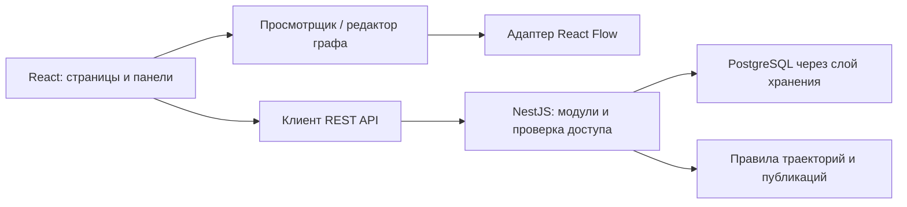

# SkillTree — архитектура первой функциональной части

Статус на 20 октября 2026 года: текущий клиент показывает Middle React, Vue, Node.js, Python и Java на React Flow с раскрытием одной специальности. Общие темы едины, языки и фреймворки независимы. Обзор содержит начало и пять профессий; выбранная траектория раскрывается отдельно, с анимацией и подбором масштаба. Смысловые блоки соединены короткими переходами до проекта; настоящие предпосылки хранятся отдельно от порядка прохождения. Архитектура серверных модулей и БД остаётся проектом. [Геометрия карты](CAREER_MAP.md), [состав пяти профилей](FIVE_CAREERS.md), [проверки](LAYOUT_VALIDATION.md).

## Основное решение

В одном репозитории находятся React-приложение, сервер NestJS и небольшие общие описания данных. Сервер запускается одним приложением, внутри функциональность разделена на модули. PostgreSQL хранит предметные данные, Prisma обслуживает обычные запросы и миграции. Специальные SQL-запросы изолируются в слое хранения.



Первый кандидат для визуализации — React Flow. Постоянная группировка, правила освоения и маршрут принадлежат модели SkillTree; координаты и служебные поля библиотеки не должны становиться единственным форматом хранения данных.

## Предлагаемая структура

```text
SkillTree/
  apps/
    web/src/
      app/                     маршруты и подключение общих компонентов
      features/
        graph/                 просмотр, группы, выделение и адаптер движка
        trajectory/            выбор цели и отображение маршрута
        graph-editor/          редактирование
        account/               вход и регистрация
        node-details/          карточка технологии, заметки, прогресс
        community/             публикации, комментарии, реакции
        profile/               профиль и настройки видимости
      shared/                  общие элементы интерфейса и API-клиент
    api/src/modules/
      catalog/                 базовые технологии, компетенции и роли
      graphs/                  личные графы, вершины и связи
      trajectories/            обязательные предпосылки и альтернативы
      auth/                    вход, сессии и выход
      users/                   профиль и настройки
      learning/                личные заметки и прогресс
      publications/            отдельные публичные версии
      social/                  комментарии и реакции
  packages/
    contracts/                 небольшие общие контракты данных
    graph-domain/              чистые правила графа без React и NestJS
  docs/
```

Это целевая структура, папки и модули создаются по мере работы. Не создавать пустые реализации модулей 11–18. Сначала достаточно обычных npm workspaces; дополнительная система сборки монорепозитория не нужна без выявленной потребности.

Текущая реализация класса `Vertex` без типов сложности, тематических файлов данных, сцен и вкладок описана в [модели карты](CAREER_MAP.md). Адаптеры сохраняют совместимость с прежними алгоритмами; координаты не входят в класс.

## Модель данных

| Сущность | Назначение и принадлежность |
| --- | --- |
| CatalogNode | Общая технология, методология, компетенция, базовая тема или специальность. Стабильный ID, название, варианты названия, тип, описание. |
| CatalogRelation | Типизированная связь общего каталога; связи сходства хранятся отдельно от обязательных зависимостей. |
| CompetencyOutcome | Проверяемый результат: что человек должен уметь делать. Привязка к технологиям и требованиям роли. |
| RequirementSet / RequirementMember | Обязательные предпосылки: набор ALL требует всех членов, набор ANY позволяет выбрать один. Это точнее, чем считать любую соседнюю вершину обязательной. |
| Graph | Граф с владельцем, названием, версией и происхождением: личная карта, сохранённый фрагмент или созданный с нуля. |
| GraphNode | Включение общей технологии или собственной темы в граф. Координаты, локальные изменения и ссылка на источник, если он есть. |
| GraphEdge | Связь между вершинами одного графа, с типом зависимости. Не может ссылаться на чужой граф. |
| DisplayGroup / GroupMember | Смысловая группа для отображения. Не подменяет собой компетенцию или технологию. В первой версии — дерево групп, одна основная группа для вершины в конкретном представлении. |
| UserNodeState | Личный статус освоения общей технологии. Общий ID позволяет согласованно показывать прогресс в основном и сохранённом графах. |
| NodeNote | Запись владельца в контексте конкретного графа и вершины. По умолчанию личная. Для собственных тем состояние и записи привязаны к GraphNode. |
| LearningResource / NodeResource | Материал и его привязка к технологии: ссылка, тип, язык, уровень и дата проверки. На первом этапе добавляется подготовленная подборка. |
| User / Session | Аккаунт и серверная сессия. Восстановление доступа и дополнительные способы входа оцениваются при работе над аккаунтами. |
| ProfileSettings | Публичность профиля и публичное имя; настройки не делают автоматически доступными личные графы и записи. |
| Publication / PublicationVersion | Опубликованная версия выбранного графа с явно включёнными записями. Личный оригинал остаётся отдельным. |
| Comment / Reaction | Комментарии и реакции к доступной публикации. Одна отметка заданного типа от пользователя. |

Заметки привязываются к контексту графа, прогресс по общей технологии — к пользователю и технологии. При копировании графа явно определять, какие собственные записи копируются. Чужие личные записи никогда не становятся частью копии автоматически.

## Основной и малые графы

Общий каталог содержит базовую структуру. У пользователя — личные включения/исключения, изменения, прогресс и записи поверх этой структуры. Материализовать весь каталог отдельной копией для каждого аккаунта при регистрации не требуется.

Сохранение фрагмента создаёт личный Graph с выбранными вершинами и внутренними связями. Если фрагмент не включает необходимые предпосылки, интерфейс показывает это и предлагает включить их; незаметно терять зависимости нельзя.

Первая версия сохранённого фрагмента фиксирует структуру на момент сохранения. Общие ID технологий сохраняются. Будущие изменения общего каталога не должны автоматически удалять вершины или личные записи из сохранённого графа. Полная система сравнения и слияния версий — последующее развитие, а версия источника записывается с начала.

## Группировка и масштаб

Полный каталог хранит реальные ID. Выбранная профессия определяет набор тем сцены. Смысловые группы заданы явно и остаются одним кругом при любом масштабе; нажатие открывает вкладки участников. Поиск выбирает нужную вкладку. Группа не является отдельным учебным требованием.

Внешние линии участников объединяются по отображаемым концам с сохранением исходных ID. Внутренние зависимости доступны в карточках тем. Масштаб меняет читаемость подписей и камеру, но не состав группы. Ограничения по типам сложности отменены вместе с этими типами. Автоматическая кластеризация не входит в текущую работу.

## Общие технологии и радиальная карта

Последнее уточнение заменяет прежнее размещение всей базы по кольцам: в обзоре одна центральная вершина «Начало» и специальности вокруг неё. Технологии появляются только в выбранной траектории. Вторая специальность остаётся доступной для переключения.

У технологии один ID и одна запись в каталоге. Разные роли ссылаются на ту же сущность, а её координаты вычисляются для конкретной сцены. Поэтому общие знания не дублируются, но не создают постоянно видимые межветочные линии. Часто встречающаяся технология не объявляется обязательной для всех: состав пути определяется требованиями профессии.

| Контекст | Отображение |
| --- | --- |
| Обзор | Начало и специальности; технологии скрыты. |
| Выбрана профессия | Все её темы и дерево основных зависимостей. Чужие технологии отсутствуют. |
| Выбрана тема | Её дополнительные зависимости и полная карточка; прочие линии приглушены. |
| Смена профессии | Старая ветка затухает, новая раскрывается; поздний результат отменённого перехода игнорируется. |
| Редактор, будущий модуль | Доступ к полному списку реальных зависимостей. |

Связи навигации от начала и специальности не имеют стрелок предварительного требования. Стрелки между технологиями обозначают настоящие зависимости. Обзорное дерево не заменяет полный список требований: карточка и модель сохраняют все связи. Подробнее: [текущая компоновка](CAREER_MAP.md).

## Построение траектории

Последнее уточнение пользователя: сначала одна полноценная ветка Middle React с параллельными компетенциями и объединением знаний. `Topic.prerequisites` задаёт предметный DAG. `Role.learningOrder` сохранён для совместимости раннего прототипа, но не используется текущим экраном и не определяет его связи.

Активный каталог `skill-catalog.ts` расширяет исходные фронтенд-профили до пяти профессий и 108 компетенций/проектов. `frontend-catalog.ts` сохраняет исходные две профессии для сравнений и исторических тестов. Общие темы связаны едиными ID. Серверные пути используют общую базу данных/API/безопасности и отдельные языки, фреймворки и итоговые проекты; Java и Python не зависят от браузерных тем.

Активный `career-scene.ts` размещает специальности вокруг начала и строит выбранную ветку по соседним шагам. `career-curriculum.ts` и `backend-curriculum.ts` описывают блоки отдельно от настоящих предпосылок. Плавание смещает отображение в радиусе до 8 единиц и синхронно пересчитывает прямые соединения. Геометрия проверяется отдельно от React. Прежние ELK Layered и `layoutRadialKnowledgeGraph` сохранены для сравнений и исторических тестов.

Обзор реализован для текущих пяти профессий. Названия и сокращения всегда находятся внутри кругов и масштабируются вместе с ними, без внешних подписей и скрытия текста при отдалении. Ранний прототип сохранён в `SequentialPrototype.tsx` и не подключён к текущему экрану. Замеры на 800 узлах относятся к прежней реализации, а не к текущей сцене выбранной профессии.

Профессии имеют устойчивые идентификаторы и варианты названия. «Java-разработчик» и «Java-инженер» могут быть вариантами одной роли либо разными ролями при разных требованиях; не создавать различия только ради похожего названия.

По цели и текущим знаниям собираются все обязательные предпосылки, а не одна кратчайшая цепочка. Для ANY-наборов выбирается вариант; неизвестные темы не считаются освоенными. Затем строится допустимый порядок изучения и объяснение необходимых тем.

Сначала проверить одну подготовленную роль Middle React; после согласования её полноты расширять каталог другими специальностями. Близость будущих ролей считать по пересечению компетенций и показывать причину рекомендации.

## Доступ и публикации

| Объект / действие | Гость | Владелец | Другой вошедший пользователь |
| --- | --- | --- | --- |
| Общий каталог | Чтение | Чтение, личное представление | Чтение |
| Личный граф, записи, прогресс | Нет | Чтение/изменение | Нет |
| Доступная опубликованная версия | Чтение | Чтение, обновление через новую версию, снятие публикации | Чтение |
| Комментарии и реакции | Чтение доступных | Создание своих, управление своими | Создание своих, управление своими |
| Закрытый профиль | Нет | Чтение/изменение | Нет |
| Открытый профиль | Только разрешённые публичные поля | Чтение/изменение | Только разрешённые публичные поля |

Проверки выполняет сервер для каждого объекта, включая вложенные вершины, заметки и версии. Знание ID не даёт доступа. Валидация TypeScript на клиенте не заменяет проверку входных данных на сервере.

Для первой браузерной версии предлагаются серверные сессии с HttpOnly cookie. Настройки Secure, SameSite, срок сессии, ограничение попыток входа и защита изменяющих запросов определяются при реализации аккаунтов с учётом размещения web/API. Пароли хранятся через подходящую функцию хеширования; конкретную библиотеку проверить в пункте 5. Токены в localStorage не являются частью предлагаемой схемы.

Перед публикацией пользователь видит состав публикуемых данных. После публикации новые личные изменения не попадают в неё автоматически. При снятии публикации её содержание, комментарии и реакции не доступны посторонним через прямой запрос.

## Карта экранов первой части

| Экран | Состав и основное действие |
| --- | --- |
| Карта навыков | Поиск профессии, граф, группы, масштаб, легенда, карточка выбранной технологии. |
| Мои графы | Личная карта и сохранённые графы; открыть, переименовать, создать, удалить собственный. |
| Просмотр малого графа | Тот же компонент графа, карточки, заметки, прогресс; переход к редактированию. |
| Редактор | Режимы добавления вершины/связи, изменения, удаления, отмена последнего локального действия перед сохранением. |
| Вход / регистрация | Аккаунт, ошибки проверки, вход и выход. |
| Публикация | Предварительный просмотр, выбор включаемых записей, действие публикации. |
| Сообщество / опубликованный граф | Список публикаций, просмотр выбранной версии, комментарии и отметка «нравится». |
| Профиль и настройки | Свои графы, личная статистика, публичное имя и публичность профиля. |

## Главный экран

Сверху расположена навигация: карта, мои графы, сообщество, курсы, пет-проекты и профиль. Карта занимает всю область окна под навигацией, без левого sidebar, рекламных заголовков, счётчиков и общего футера. Реализована навигационная оболочка; будущие модули показывают честный статус разработки и ссылку возврата к карте.

Поиск, выбор специальности и кнопки масштаба находятся внутри карты. Карточка появляется только после выбора технологии, поверх правой части карты. Она содержит вкладки группы, описание, результат обучения, материалы и все настоящие предпосылки. Закрывается крестиком, Escape или нажатием пустого места карты.

На узком экране та же карточка закреплена снизу внутри карты; её содержимое прокручивается отдельно. Камера направляет выбранную вершину в свободную область над карточкой или слева от неё. Страница целиком не прокручивается.

При переходе в другой модуль граф сохраняет размеры и состояние, становится невидимым и не участвует в навигации с клавиатуры. Весь слой карты скрывается через `opacity: 0` вместе с `visibility: hidden` и `inert`: одной наследуемой видимости недостаточно, поскольку React Flow явно делает свои вершины видимыми. Модули располагаются в отдельном слое с непрозрачным фоном. Размеры карты не обнуляются, что предотвращает некорректный масштаб при возврате. URL раздела задаётся хешем; история переходов работает штатно.

Актуальные стили оболочки находятся в `workspace.css`, стили вершин и анимаций — в `knowledge.css`. Прежний `styles.css` относится к неиспользуемому прототипу и не подключён в текущем приложении.

## Готовность пункта 0

- [x] Требования, рабочий срок и первая функциональная часть записаны.
- [x] Предложены границы модулей, модель данных, карта экранов и правила доступа.
- [x] Подготовлен макет основного экрана с двумя вариантами положения карточки.
- [x] Выбрана компоновка: верхняя навигация, карта на всю область окна и карточка внутри карты.
- [x] Создан небольшой прототип с настоящим React Flow и необходимой группировкой.
- [x] Проверены 100/300/800 вершин и записаны результаты на указанном компьютере/браузере.
- [ ] Проверен небольшой пример сохранения связей и личных данных в PostgreSQL.
- [x] Для графа зафиксировано решение: React Flow с постоянными группами и вкладками тем; ограничение полного режима 800 сохранено в отчёте. Решение о хранении проверяется отдельно.

Не отмечать пункт 0 завершённым только по документам и иллюстрации.

## Официальные технические основания

- Модули NestJS: https://docs.nestjs.com/modules
- Проверка прав в NestJS: https://docs.nestjs.com/security/authorization
- Состояние React Flow: https://reactflow.dev/learn/advanced-use/state-management
- Пример изменения деталей по масштабу: https://reactflow.dev/examples/interaction/contextual-zoom
- Ограничения и оптимизация отображения: https://reactflow.dev/learn/advanced-use/performance

Пример contextual zoom подтверждает возможность менять представление узла по масштабу. Автоматическое объединение произвольных технологий не считается готовой функцией React Flow: это часть модели и адаптера SkillTree, которую требуется реализовать и проверить.
